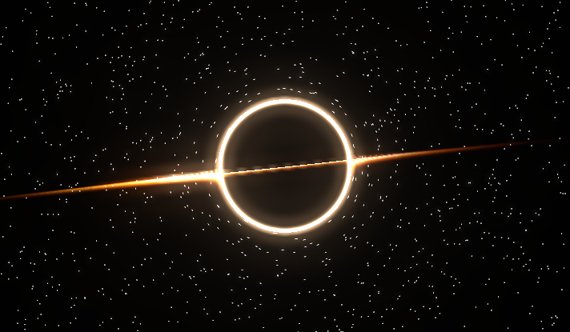

# 3D Black Hole



Interactive 3D black hole experience created with modern web technologies. The project features a visually immersive black hole with a glowing accretion disk, realistic lighting effects, depth and spatial movement.

The goal of the project was to experiment with 3D graphics, lighting, animations and visual effects directly in the browser.

### Features

- 🌌 Interactive 3D black hole
- 🌀 Animated accretion disk
- ✨ Dynamic lighting and visual effects
- 🎥 Interactive camera movement
- ⚡ Real-time 3D rendering
- 💻 Built for the web

### Technologies

- Three.js
- React
- Vite
- JavaScript
- WebGL
- HTML
- CSS

### Run locally

1. Install dependencies:
   ```bash
   pnpm install
   ```
2. Start the development server:
   ```bash
   pnpm run dev
   ```
3. Open the local URL shown in the terminal, usually:
   ```bash
   http://localhost:5173/
   ```

A small 3D experiment focused on creating an immersive and visually interesting space environment in the browser.
